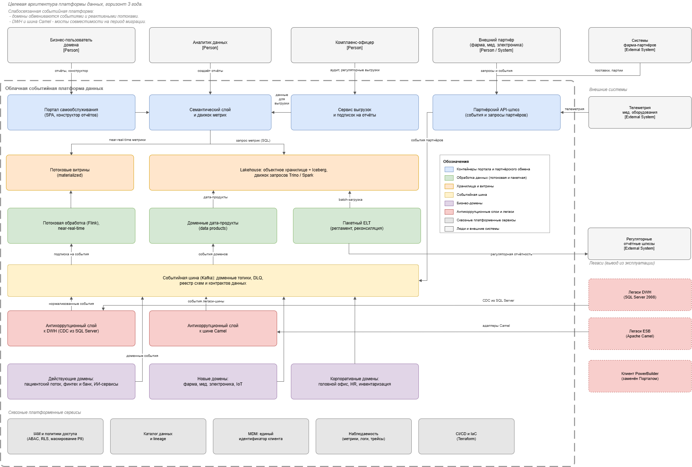
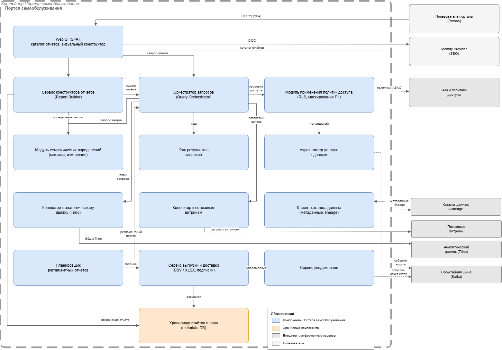

# Проектирование целевой архитектуры и оценка рисков внедрения

Описание целевой архитектуры в течение трёх лет.

## C4, уровень 2. Целевая архитектура

Целевое состояние - слабосвязанная событийная платформа в облаке. Домены обмениваются данными через события и реактивные потоки, DWH и шина Camel остаются только мостами совместимости на период миграции и выводятся из эксплуатации. Ключевые решения:  

- Событийная шина (Kafka) как основа интеграции: доменные топики, DLQ и реестр схем и контрактов данных. Синхронные точечные интеграции на критическом пути убираются  
- Масштабирование по доменам: действующие (пациентский поток, финтех и банк, ИИ-сервисы), новые (фарма, мед. электроника, IoT) и корпоративные (головной офис, HR, инвентаризация) подключаются единообразно через шину без внесения бизнес-логики в DWH  
- Витрина данных не включает медицинские карты, истории болезни и результаты исследований - это ограничение закреплено политиками доступа и каталогом  
- Партнёрский API-шлюз для новых бизнес-направлений (фарма, производитель мед. электроники, IoT-телеметрия): приём событий и запросов партнёров, публикация в шину  
- Сквозные платформенные сервисы для всех контейнеров: IAM с ABAC, RLS и маскированием PII, каталог данных и lineage, MDM с единым идентификатором клиента, наблюдаемость, CI/CD и IaC на Terraform  
- Хранение по модели Lakehouse: объектное хранилище с табличным форматом Iceberg и движком запросов Trino / Spark для исторической аналитики, плюс потоковые витрины (materialized) для near-real-time  
- Обработка разделена на потоковую (Flink), пакетный ELT для регламента и реконсиляции и доменные дата-продукты, которые домены публикуют и поддерживают сами  
- Антикоррупционные слои к DWH (через CDC из SQL Server) и к шине Camel нормализуют легаси-данные в события и имеют заранее определённые критерии вывода  
- Переход от batch к near-real-time: оперативные показатели считаются на потоке, регламентная отчётность - пакетно и служит источником истины при сверке  
- Портал самообслуживания вместо клиента PowerBuilder: SPA с конструктором отчётов, семантический слой как единый источник определений метрик, сервис выгрузок и подписок  

## C4, уровень 3. Компоненты портала самообслуживания

Детализация контейнера "Портал самообслуживания" с диаграммы уровня 2.

- Сервис конструктора отчётов формирует модель отчёта и сохраняет её в хранилище отчётов и прав  
- Коннекторы к аналитическому движку (Trino) и к потоковым витринам разделяют исторические и near-real-time запросы  
- Web UI (SPA) - каталог отчётов и визуальный конструктор, аутентификация через Identity Provider по OIDC  
- Планировщик регламентных отчётов, сервис выгрузки и доставки (CSV / XLSX, подписки) и сервис уведомлений обеспечивают регулярную рассылку; события о готовности и аудите уходят в событийную шину  
- Оркестратор запросов планирует выполнение, обращается к семантическим определениям, кэшу результатов и модулю применения политик доступа  
- Модуль применения политик доступа применяет RLS и маскирование PII, получает политики из платформенного IAM, пишет решения в аудит-логгер  
- Клиент каталога данных отдаёт метаданные и lineage в UI и во внешний каталог  

## Карта рисков

Риски разбиты на три группы, для каждого указаны вероятность (низкая / средняя / высокая), влияние на бизнес (низкое / среднее / высокое) и производный уровень. Детальное описание вот тут [risk map](risk_map.md).

Критические риски:

- домены не берут ответственность за свои дата-продукты, всё стекается в центральную команду  
- миграция сотен терабайт из SQL Server 2008 без нативного CDC  
- расхождение контрактов данных между доменами при росте числа событий  
- дефицит компетенций по облаку, Kafka, Flink, Lakehouse и зависимость от ключевых людей  

Высокие риски включают событийную шину как единую точку отказа, дублирование бизнес-логики и расхождение метрик, закрепление временных антикоррупционных слоёв, ошибочную нарезку границ доменов, тяжёлые ad-hoc запросы портала, несоблюдение требований регуляторов, недооценку бюджета программы, двойную поддержку легаси, утечку PII, рост облачных затрат, низкое качество данных источников и недостижение целевых RPO / RTO.

Средние риски: неконсистентность потокового и пакетного путей, сопротивление отказу от легаси, размытая ответственность платформы и доменов, vendor lock-in, нестабильность партнёрских интеграций, несовместимость схем при эволюции витрин.

## План управления рисками

Для каждого риска перечислены меры с пометкой типа: техническое решение реализуется в архитектуре, коде и настройках платформы; управленческий подход - это процессы, роли, регламенты, планирование и обучение. Меры привязаны к этапам программы трансформации и имеют владельца. Детальное описание вот тут [risk management plan](risk_management_plan.md). 

Распределение по способу управления:

- сочетания технических и управленческих мер требуют контракты данных, консолидация метрик, границы доменов, требования регуляторов и качество данных  
- преимущественно управленческими подходами снижаются вывод антикоррупционных слоёв, дефицит компетенций, владение дата-продуктами, сопротивление отказу от легаси, разграничение ответственности, бюджет программы и двойная поддержка  
- преимущественно техническими решениями снижаются риски отказоустойчивости шины, консистентности расчётов, производительности запросов портала, миграции данных, vendor lock-in, защиты PII, роста затрат, RPO / RTO и эволюции схем  
