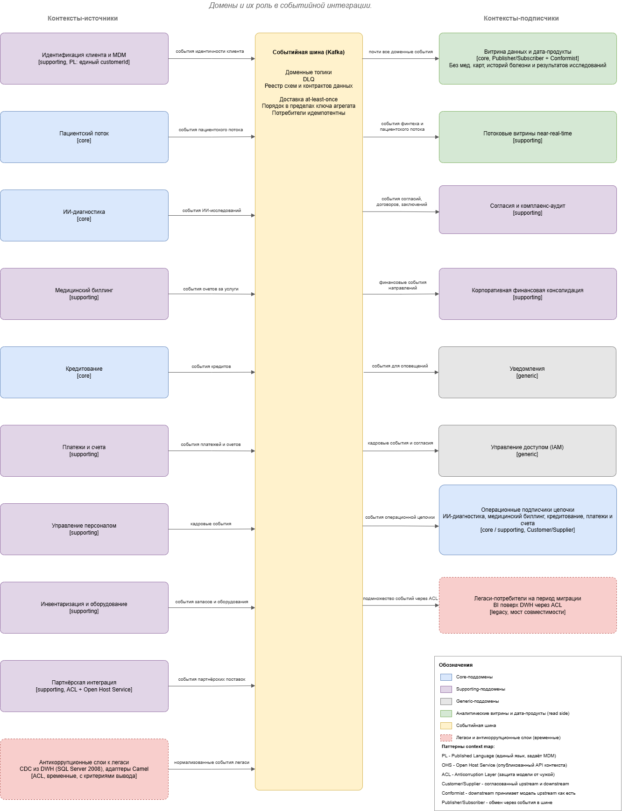
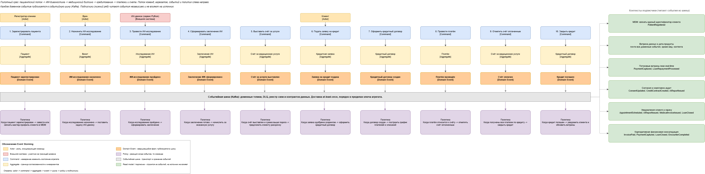

# Моделирование домена и интеграций

Разбиение системы с использованием подхода Domain-Driven Design, целевая событийная архитектура в виде Event Storming и обоснование перехода на интеграцию через события вместо шины Camel и DWH

## Bounded contexts

Система разбита на 14 bounded contexts, сгруппированных по типу поддомена:

- Core: пациентский поток, ИИ-диагностика, кредитование, витрина данных и дата-продукты  
- Generic: управление доступом (IAM), уведомления  
- Supporting: идентификация клиента и MDM, медицинский биллинг, платежи и счета, управление персоналом, инвентаризация и оборудование, партнёрская интеграция, согласия и комплаенс-аудит, корпоративная финансовая консолидация  

Ключевые решения по интеграции:

- Легаси DWH (SQL Server 2008) и шина Camel подключаются к событийной модели через антикоррупционные слои (CDC и адаптеры) как временные мосты совместимости с заранее определёнными критериями вывода  
- Партнёрская интеграция подключает внешние системы фарма-партнёров и производителя электроники через Open Host Service и Anticorruption Layer  
- Идентификация клиента и MDM задаёт Published Language: единый customerId и словарь идентификаторов, остальные контексты - Conformist к этому языку  
- Цепочка "пациентский поток -> ИИ-диагностика -> медицинский биллинг -> кредитование -> платежи и счета" строится по паттерну Customer/Supplier и работает на событиях  
- Обмен между контекстами идёт через событийную шину (Kafka): доменные топики, DLQ, реестр схем и контрактов данных, доставка at-least-once, порядок в пределах ключа агрегата, идемпотентные потребители  
- Витрина данных и дата-продукты - downstream-подписчик (Publisher/Subscriber, Conformist), в него не публикуются медицинские карты, истории болезни и результаты исследований  

Описание границ и инвариантов ключевых [агрегатов](aggregate.md)

## Event Storming

Диаграмма показывает пилотный срез целевой архитектуры: поток от регистрации пациента до погашения кредита. Слева направо идут команды, агрегаты, доменные события и политики ("когда событие, то команда"). Каждое доменное событие публикуется в событийную шину, из которой независимо читают контексты-подписчики (нижний ряд: MDM, витрина данных, потоковые витрины, комплаенс-аудит, уведомления, корпоративная финансовая консолидация). Основные события и их источники:

- Медицинский биллинг: "Счёт за услуги выставлен", "Счёт оплачен"  
- Пациентский поток: "Пациент зарегистрирован", "ИИ-исследование назначено"  
- ИИ-диагностика: "ИИ-исследование пройдено", "Заключение ИИ сформировано"  
- Платежи и счета: "Платёж проведён"  
- Кредитование: "Заявка на кредит подана", "Кредитный договор создан", "Кредит погашен"  

Описание полного каталога [событий](event.md) с семантикой, минимальным контрактом полезной нагрузки, единым конвертом события и матрицей "источник - подписчики"

## Обоснование событийного подхода

[Преимущества](justification.md) перехода от Camel и DWH к интеграции через события:

- Скорость реакции: события обрабатываются по мере поступления, оперативные показатели считаются на потоке; реактивные цепочки идут без ручных выгрузок и сверок; сбой потребителя не теряет данные (топик, повтор, DLQ)  
- Масштабируемость: топики партиционируются, потребители масштабируются независимо; подключение нового бизнес-направления - это новый набор топиков, а не новые точечные маршруты ко всем системам; хранение и обработка разделены на потоковый и пакетный контуры  
- Гибкость: домены публикуют факты, не зная о потребителях; бизнес-логика уходит из общего DWH в домены-владельцы; интерфейс между доменами фиксируется версионируемыми контрактами в реестре схем; новый потребитель подписывается на существующий поток без изменений в источнике  

Camel и DWH на период миграции остаются мостами совместимости: CDC и адаптеры через антикоррупционные слои превращают легаси-данные в события, для каждого моста заданы критерии вывода из эксплуатации
